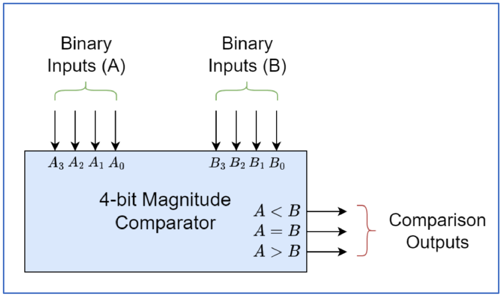
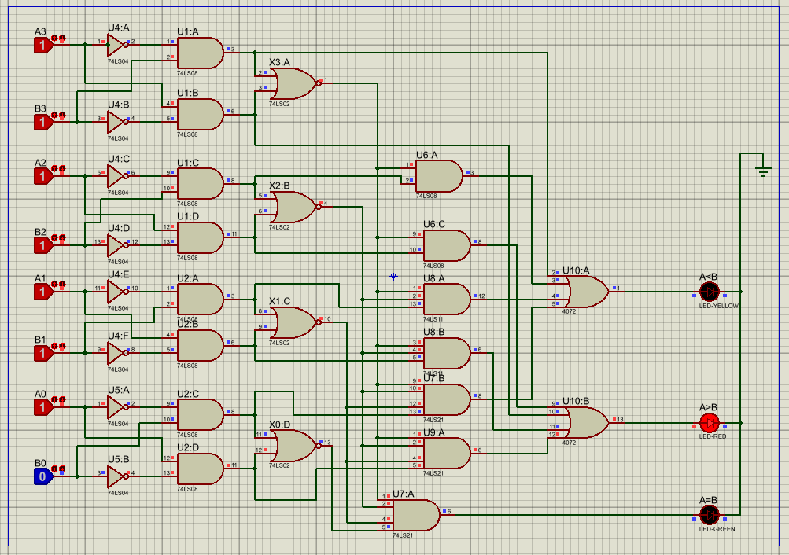
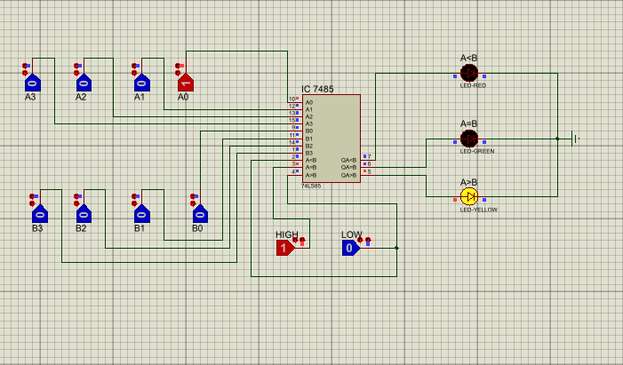
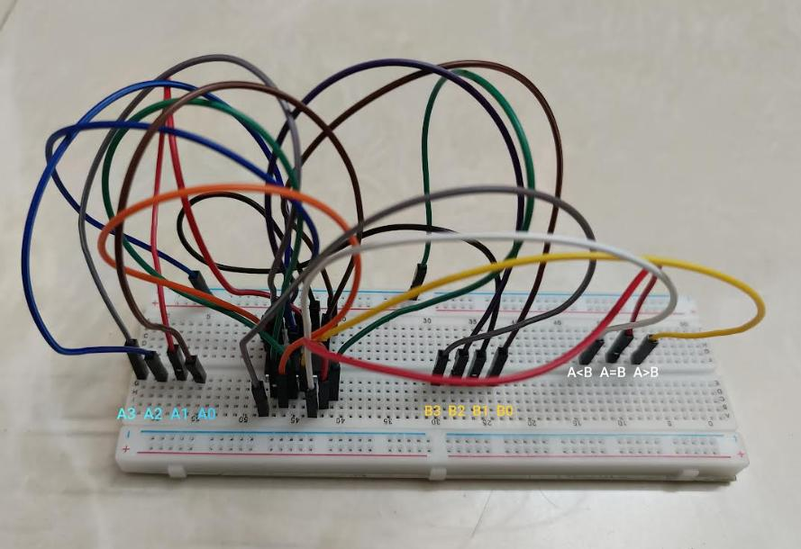
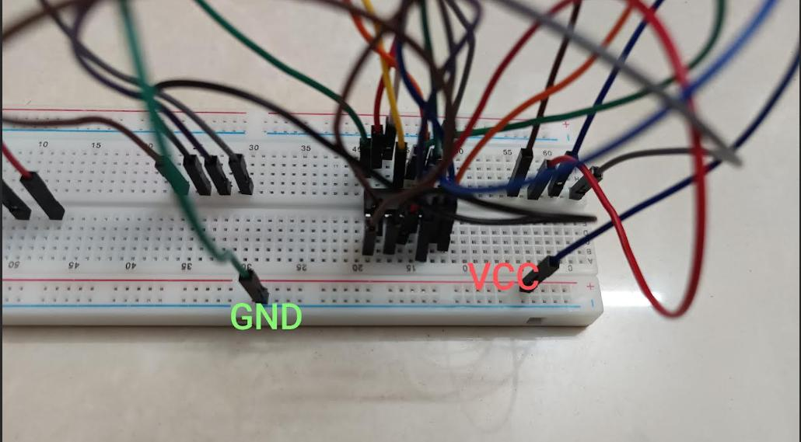

# 4-bit Magnitude Comparator



**A complete design, simulation, HDL-verification and hardware-implementation study of a 4-bit
magnitude comparator, produced for CSE345 — Digital Logic Design at East West University.**


---

## Overview

The comparator takes two unsigned 4-bit binary inputs, `A` and `B`, and produces three mutually
exclusive outputs: `A > B`, `A = B` and `A < B`. The project implements the same function at three
levels — a discrete-gate circuit, a Proteus simulation around the 74LS85 comparator IC, and two
Verilog models — and also assembles it on a breadboard.

The academic work was submitted in September 2025. The documentation, image curation and exhaustive
source-level verification in this repository were prepared in 2026 and are identified as such.

| | |
|---|---|
| Course | CSE345 — Digital Logic Design |
| Institution | Department of Computer Science and Engineering, East West University |
| Group / Section | Group 7, Section 6 |
| Semester | Summer 2025 |
| Faculty | Nishat Tasnim |
| Submitted | September 2nd, 2025 |

## Features

- Comparison from the most significant bit downwards, with priority given to the highest differing bit.
- Three one-hot outputs: exactly one of `GT`, `EQ` and `LT` is high for every input pair.
- A gate-level implementation built from standard TTL/CMOS logic devices.
- A 74LS85-based implementation, simulated and prototyped on a breadboard.
- Two Verilog descriptions — procedural and dataflow — reconstructed from the original report.
- A self-checking testbench covering all 256 input combinations plus 13 regression vectors.
- Thirteen genuine Proteus screenshots, two hardware photographs and two block diagrams.

## Comparator behaviour

| Condition | `GT` | `EQ` | `LT` | Example |
|---|---|---|---|---|
| `A > B` | 1 | 0 | 0 | `A = 1001`, `B = 0101` |
| `A = B` | 0 | 1 | 0 | `A = 1010`, `B = 1010` |
| `A < B` | 0 | 0 | 1 | `A = 0011`, `B = 0101` |

Equality is detected by XNOR-ing each bit pair and AND-ing the four results. The greater-than and
less-than terms are qualified by equality of all higher bits; the full derivation is in
[Circuit Design](docs/CIRCUIT_DESIGN.md).

## Architecture

Two 4-bit inputs enter the comparator block and three comparison outputs leave it. The image above
shows the MSB-first labelling used throughout the documentation. The original submitted figure
labelled the inputs least significant bit first; it is preserved in the
[Asset Index](docs/ASSET_INDEX.md#original-block-diagram) so the correction can be verified.

| Implementation | File / evidence | Verification |
|---|---|---|
| Gate-level circuit | Proteus schematic, 3 screenshots | Representative cases only; no netlist |
| 74LS85 IC | Proteus schematic, 10 screenshots, breadboard | Representative cases and physical assembly |
| Procedural Verilog | `src/rtl/comparator_4bit_procedural.v` | 256 / 256 exhaustive checks |
| Dataflow Verilog | `src/rtl/comparator_4bit_dataflow.v` | 256 / 256 exhaustive checks |

See [Project Overview](docs/PROJECT_OVERVIEW.md) for the scope, objectives and tools.

## Visual gallery

A curated selection of the genuine project imagery is shown below. The complete illustrated
catalogue — all 17 images with individual captions — is in the [Asset Index](docs/ASSET_INDEX.md).

### Circuit and gate-level simulation

| Block diagram | Gate-level Proteus simulation |
|---|---|
|  |  |
| *MSB-first comparator interface.* | *`A = 1111`, `B = 1110`; `A > B` is lit.* |

### Proteus simulation



*The 74LS85 IC with `A = 0001` and `B = 0000`; the `A > B` indicator is lit. All thirteen captures,
including equality and less-than cases, are catalogued in the
[Simulation Guide](docs/SIMULATION_GUIDE.md#the-thirteen-captures).*

### Hardware implementation

| Assembled prototype | Power wiring |
|---|---|
|  |  |
| *Annotated inputs and outputs.* | *`VCC` and `GND` rails.* |

The photographs document that the prototype was built and powered; they do not record the LED state
for a specific input. See [Hardware Implementation](docs/HARDWARE_IMPLEMENTATION.md).

## Source code

```text
src/
├── rtl/
│   ├── comparator_4bit_procedural.v   procedural (always @*) model
│   └── comparator_4bit_dataflow.v     dataflow (continuous assign) model
└── tb/
    └── comparator_4bit_tb.v           self-checking testbench (2026, Nafis Afzal)
```

The two RTL files are faithful reconstructions of the listings printed in the 2025 report. The
testbench is new 2026 work and was not part of the original submission.

## Simulation and testing

Requires [Icarus Verilog](https://steveicarus.github.io/iverilog/) (verified with version 12.0).

```bash
iverilog -g2005 -Wno-timescale -o build/comparator_4bit_tb.vvp \
         src/rtl/comparator_4bit_procedural.v \
         src/rtl/comparator_4bit_dataflow.v \
         src/tb/comparator_4bit_tb.v
vvp build/comparator_4bit_tb.vvp
```

| Check | Scope | Result |
|---|---|---|
| Exhaustive sweep, both models | 256 input combinations | 256 / 256 correct |
| One-hot property | 256 input combinations | 0 violations |
| Regression vectors | 13 Proteus cases | 13 / 13 correct |
| Checks performed | — | 256 |
| Errors | — | **0** — `TESTBENCH RESULT: PASS` |

These results verify the **Verilog source models only**. They do not verify the gate-level Proteus
schematic (no gate-level netlist exists) and are not physical-hardware testing. Full details are in
[Testing and Results](docs/TESTING_AND_RESULTS.md).

## Limitations

- Unsigned 4-bit values only; signed comparison and wider operands were out of scope.
- No timing or propagation-delay analysis was performed.
- The gate-level design exists only as a Proteus schematic, not as a Verilog netlist.
- The HDL verification was added in 2026; the original 2025 Verilog was documentation only.
- Breadboard photographs prove assembly and powering, not a specific comparison result.
- The two Proteus schematics use different LED colours for the same function; the mapping for the
  physical prototype could not be established.

## Team

| Member | |
|---|---|
| Nafis Afzal | Simulation development and related visual material; author of the 2026 testbench |
| Anik Saha | Simulation development and related visual material |
| Ashiqur Rahman Sohan | Collaborative project work |
| Raiyan Fardin Haque | Collaborative project work |

The project was completed jointly by all four members. The original report records no finer
breakdown of individual responsibilities.

## Documentation

- [Project Overview](docs/PROJECT_OVERVIEW.md)
- [Circuit Design](docs/CIRCUIT_DESIGN.md)
- [Simulation Guide](docs/SIMULATION_GUIDE.md)
- [Hardware Implementation](docs/HARDWARE_IMPLEMENTATION.md)
- [Testing and Results](docs/TESTING_AND_RESULTS.md)
- [Asset Index — visual gallery](docs/ASSET_INDEX.md)

## Reports

| Edition | File |
|---|---|
| Original submitted report (16 pages) | [01_Original_Submitted_Report_2025-09-02.pdf](reports/01_Original_Submitted_Report_2025-09-02.pdf) |
| Revised report — current edition (19 pages) | [02_Revised_Report_2026-11-17.pdf](reports/02_Revised_Report_2026-11-17.pdf) |

The original PDF is the September 2025 submission with the four student identifiers removed for
repository distribution; its technical content is unchanged. The revised PDF is the current report.

## Licensing

Collaborative academic coursework. No open-source licence has been granted; the contents are
provided for academic review and reference only.
