# Asset Index — Visual Gallery

[← Back to README](../README.md)

This page catalogues every image published in this repository. All images are genuine project
assets extracted from the original 2025 report; none has been generated or fabricated. The two
block-diagram files differ only in the ordering of their input labels, as explained below.

## Diagrams

### Main block diagram

*Comparator interface: `A3…A0` and `B3…B0` enter the block; `A < B`, `A = B` and `A > B` leave it.
Inputs are ordered most significant bit first, matching the equations in the project. Related:
[Circuit Design](CIRCUIT_DESIGN.md#operating-principle).*

### Original block diagram

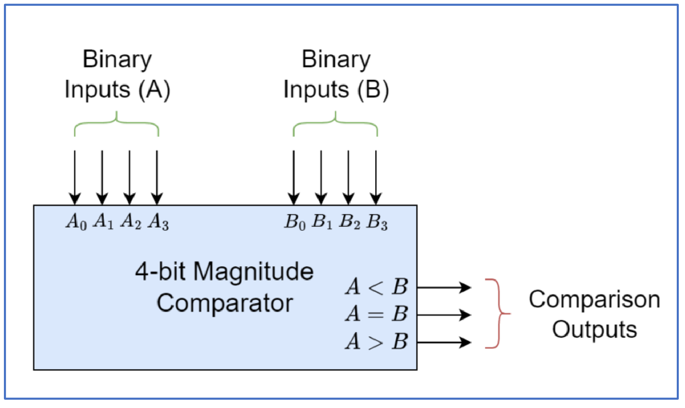

*The figure exactly as submitted in 2025, with inputs labelled least significant bit first
(`A0 A1 A2 A3`). It is retained to make the MSB-first correction above verifiable. Related:
[Circuit Design](CIRCUIT_DESIGN.md#bit-significance-and-comparison-priority).*

## Proteus simulation screenshots

The ten 74LS85 captures follow, ordered by operand value, then the three gate-level captures.

### 74LS85 circuit — A = 0000, B = 0000

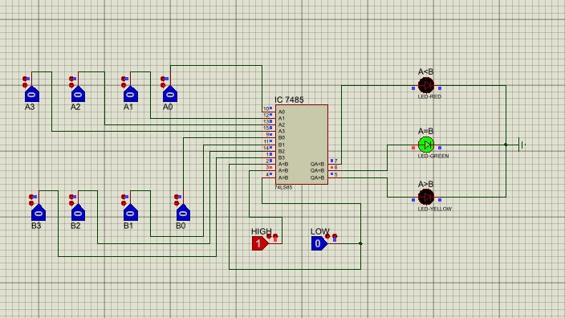

*Equality case: the `A = B` indicator is lit. Related:
[Simulation Guide](SIMULATION_GUIDE.md#the-thirteen-captures).*

### 74LS85 circuit — A = 0001, B = 0000

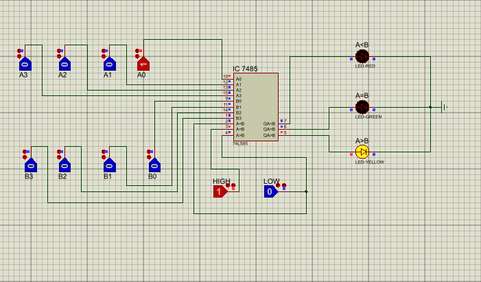

*`A = 0001` exceeds `B = 0000`; the `A > B` indicator is lit.*

### 74LS85 circuit — A = 0001, B = 0001

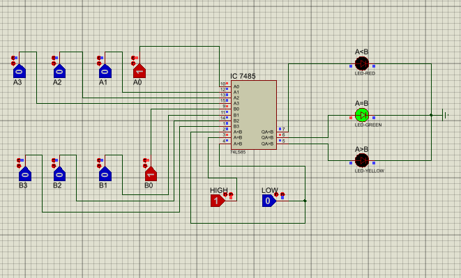

*Equality case with non-zero operands: `A = B` is lit.*

### 74LS85 circuit — A = 0011, B = 0001

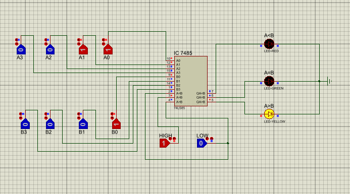

*The most significant differing bit decides the result: `A > B` is lit.*

### 74LS85 circuit — A = 0011, B = 0101

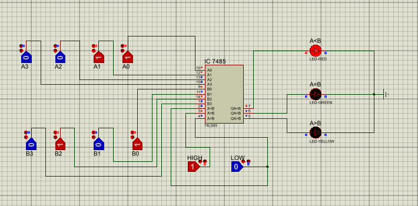

*Less-than case: the `A < B` indicator is lit.*

### 74LS85 circuit — A = 0111, B = 0101

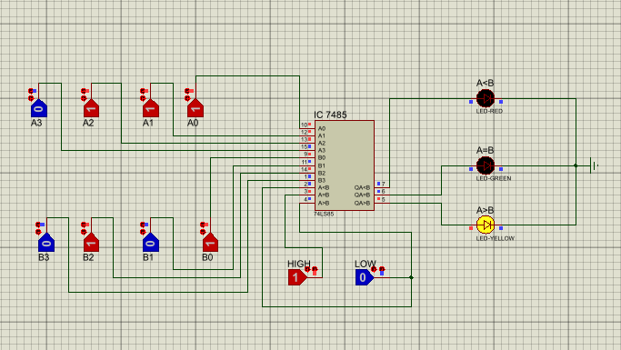

*Greater-than case with several equal high bits: `A > B` is lit.*

### 74LS85 circuit — A = 1001, B = 1000

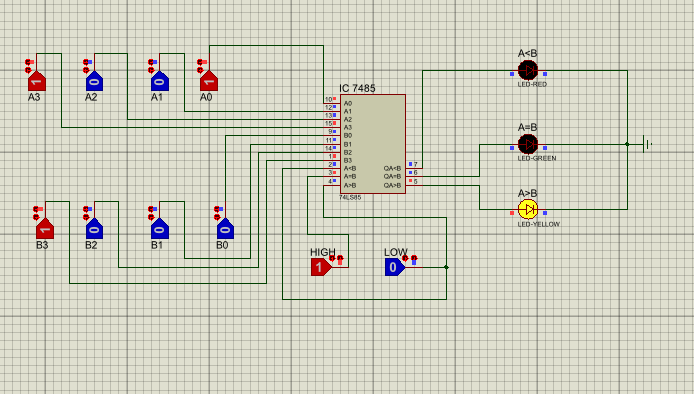

*Greater-than case decided at the least significant bit: `A > B` is lit.*

### 74LS85 circuit — A = 1001, B = 1010

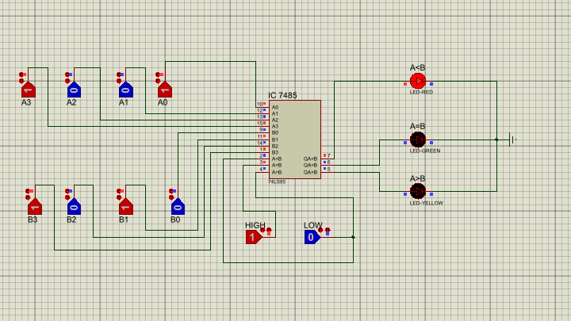

*Less-than boundary around nine versus ten: `A < B` is lit.*

### 74LS85 circuit — A = 1100, B = 1011

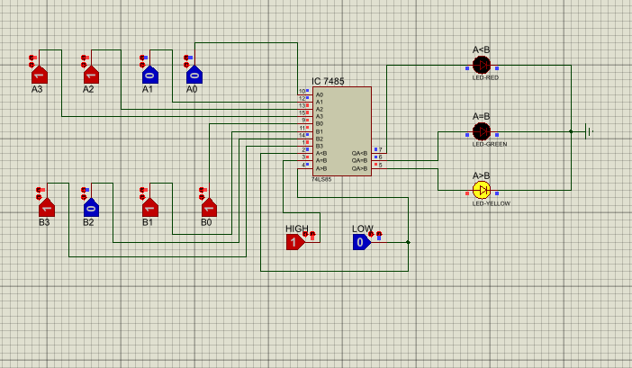

*Greater-than case with close operands: `A > B` is lit.*

### 74LS85 circuit — A = 1111, B = 1111

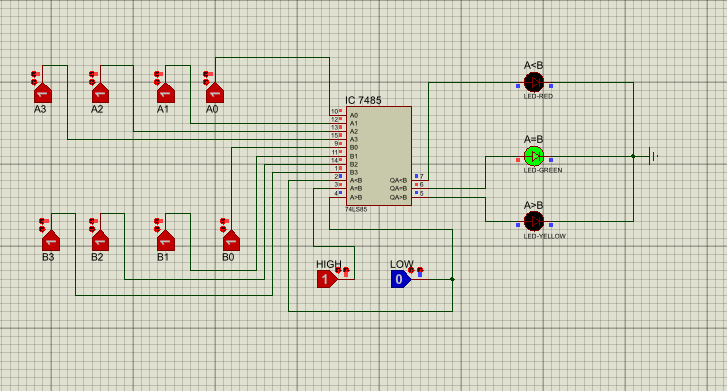

*Equality at the maximum operand: `A = B` is lit.*

### Gate-level circuit — A = 0000, B = 0000

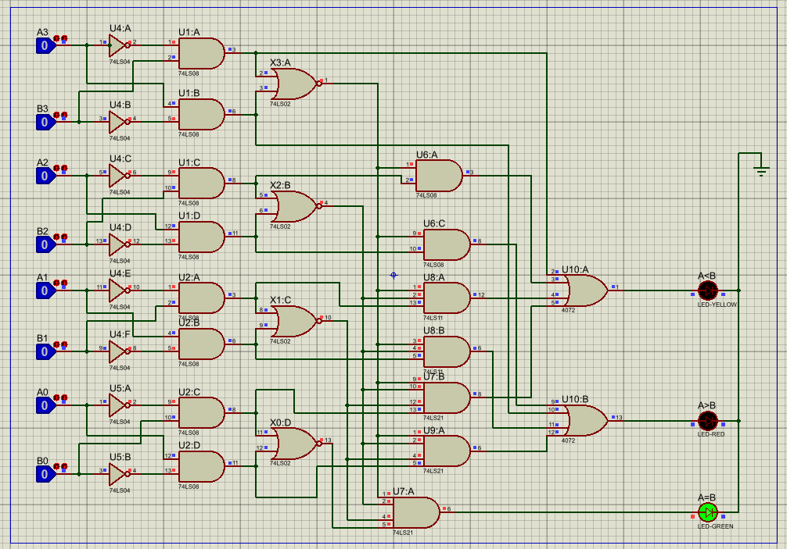

*The discrete-gate implementation produces `A = B`. Related:
[Circuit Design](CIRCUIT_DESIGN.md#explanation-of-the-actual-circuit).*

### Gate-level circuit — A = 1000, B = 0000

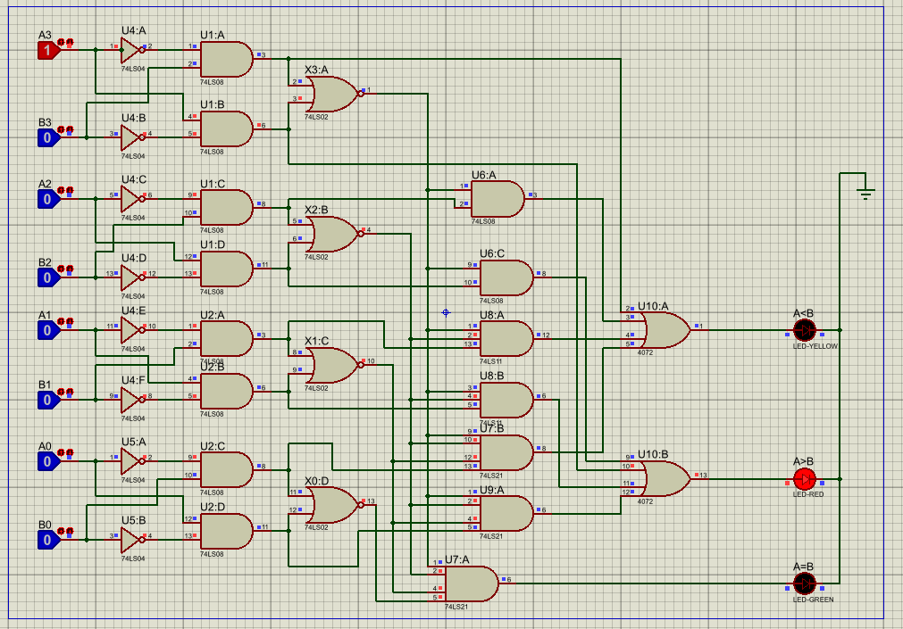

*The gate network reports `A > B` for the MSB-only difference.*

### Gate-level circuit — A = 1111, B = 1110

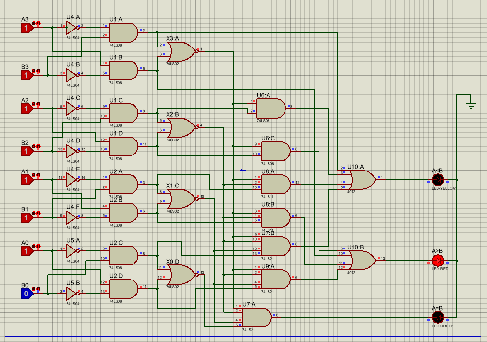

*Greater-than case decided at the least significant bit; the `A > B` indicator is lit.*

> The two schematics use different LED colours for the same function. This is documented in
> [Simulation Guide — Output indicator colours](SIMULATION_GUIDE.md#output-indicator-colours).

## Hardware photographs

### Complete breadboard assembly

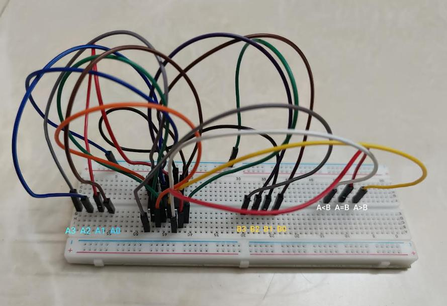

*The assembled 74LS85 prototype. Input and output positions were annotated during testing; the
photograph does not record a specific result. Related:
[Hardware Implementation](HARDWARE_IMPLEMENTATION.md#physical-implementation-overview).*

### Power wiring close-up

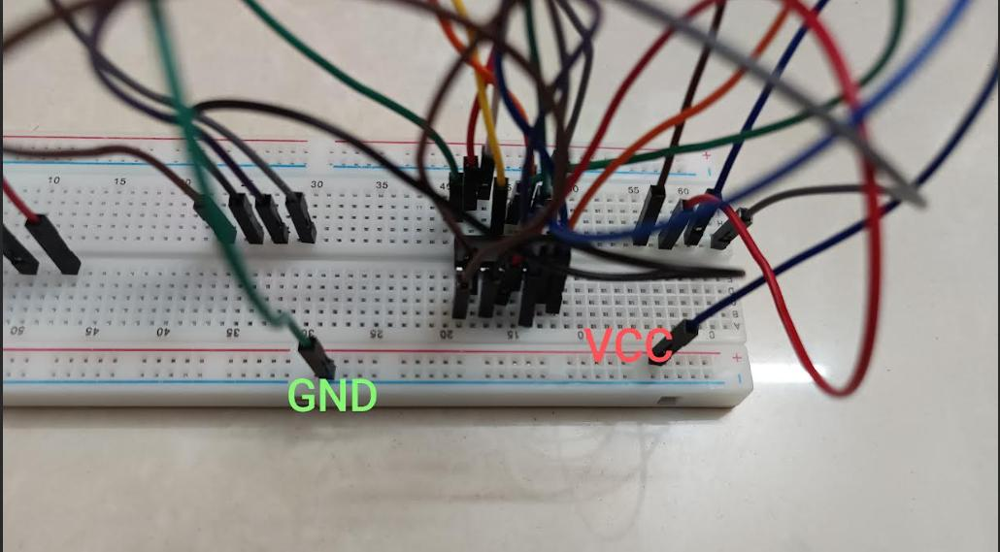

*The supply rails labelled `VCC` and `GND`. Related:
[Hardware Implementation](HARDWARE_IMPLEMENTATION.md#components).*

## Provenance

| Category | Count | Source |
|---|---|---|
| Diagrams | 2 | Original 2025 report, page 11 |
| Proteus simulations | 13 | Original 2025 report, pages 4–10 |
| Hardware photographs | 2 | Original 2025 report, page 15 |
| **Total** | **17** | All genuine, no duplicates, no fabricated images |

The original source assets remain preserved locally outside this repository. Images were copied
byte-for-byte; none was re-encoded or retouched. The East West University logo appears inside the
approved report PDFs only and is not published as a standalone asset.
