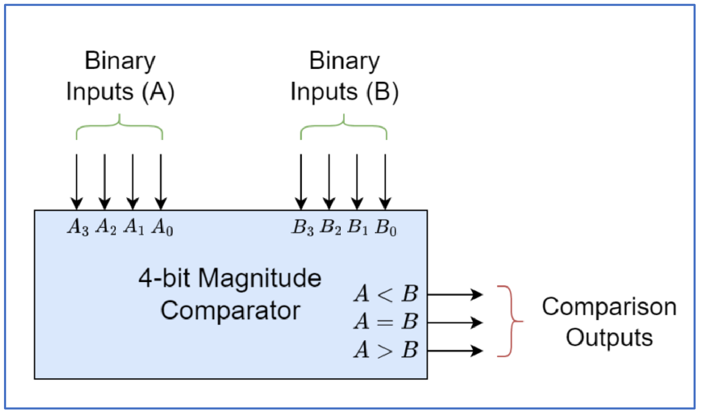
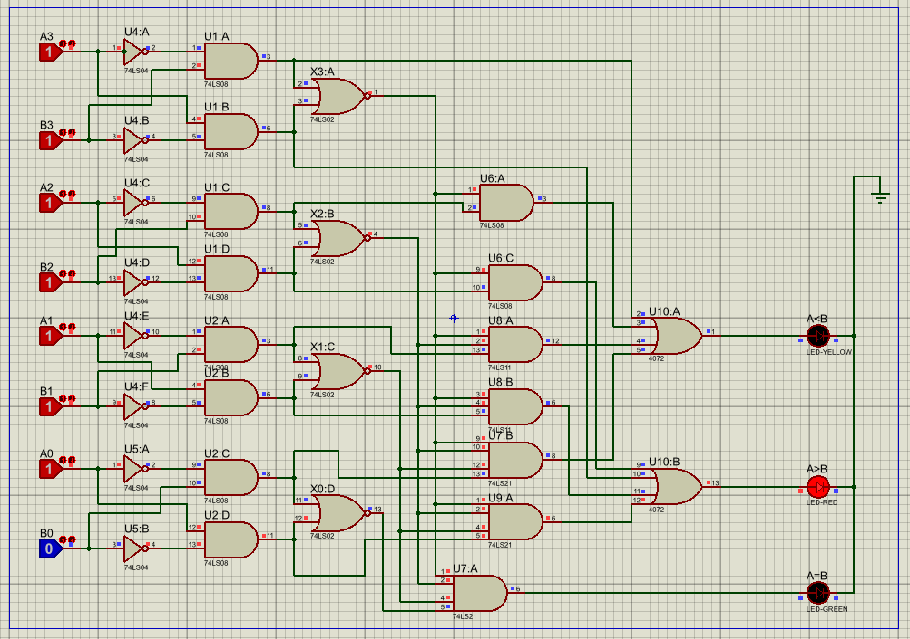

# Circuit Design — 4-bit Magnitude Comparator

[← Back to README](../README.md) · [Project Overview](PROJECT_OVERVIEW.md)

## Operating principle

Two 4-bit numbers are ordered by their most significant bit first. The comparison is decided at the
highest bit position *k* where the operands differ; bits below *k* are irrelevant once that decision
is made. This single rule produces both the gate-level circuit and the two Verilog models.



*Figure 1 — The comparator interface with MSB-first input labels and the three comparison outputs.*

The [original submitted figure](assets/diagrams/block-diagram-original.png) labelled the inputs
least significant bit first (`A0 A1 A2 A3`), which conflicted with the equations in the report.
The figure above restores the MSB-first order used throughout the project; the original is kept so
the correction can be checked.

## Bit significance and comparison priority

For bit position *i*, define the pairwise equality signal:

```
E3 = A3 XNOR B3    E2 = A2 XNOR B2    E1 = A1 XNOR B1    E0 = A0 XNOR B0
```

All four must be true for equality:

```
EQ = E3 · E2 · E1 · E0
```

### A > B

`A` is greater when the highest differing bit has `A_i = 1` and `B_i = 0`, qualified by equality
of all higher bits:

```
G3 = A3 · B3'
G2 = A2 · B2' · E3
G1 = A1 · B1' · E3 · E2
G0 = A0 · B0' · E3 · E2 · E1
GT = G3 + G2 + G1 + G0
```

### A < B

The less-than case is the mirror image:

```
L3 = A3' · B3
L2 = A2' · B2 · E3
L1 = A1' · B1 · E3 · E2
L0 = A0' · B0 · E3 · E2 · E1
LT = L3 + L2 + L1 + L0
```

These three conditions are mutually exclusive and exhaustive, so exactly one output is high for
any input pair. The testbench checks this one-hot property for all 256 combinations.

## Explanation of the actual circuit

Two implementations were built at the hardware level:

1. **74LS85 IC** — the dedicated 4-bit magnitude comparator, with its `GA>B`, `GA=GB` and `GA<GB`
   outputs wired to indicator LEDs. Its simulation is documented in the
   [Simulation Guide](SIMULATION_GUIDE.md).
2. **Gate level** — the same function from discrete devices: 74LS04 inverters for the input
   complements, 74LS08 and 74LS21 AND gates for the `Eᵢ`, `Gᵢ` and `Lᵢ` terms, 74LS02 NOR gates
   for the priority terms, and a 4072 OR gate for the final `GT` and `LT` outputs.



*Figure 2 — Gate-level schematic with `A = 1111`, `B = 1110`; the `A > B` indicator is lit.*

The gate-level circuit exists only as a Proteus schematic. No gate-level Verilog netlist was
created, so it was not part of the automated HDL verification.

## Procedural and dataflow implementation differences

| | Procedural | Dataflow |
|---|---|---|
| File | [`src/rtl/comparator_4bit_procedural.v`](../src/rtl/comparator_4bit_procedural.v) | [`src/rtl/comparator_4bit_dataflow.v`](../src/rtl/comparator_4bit_dataflow.v) |
| Style | `always @(*)` with `if / else if / else` | continuous `assign` statements |
| Behaviour | `A > B`, then `A == B`, otherwise `A < B` | boolean expressions above, one per output |
| Readability | compact; hides the individual terms | closest correspondence to the gate network |

Both modules were reconstructed from the Verilog listings printed in the original 2025 report;
their executable content is unchanged. Both are compiled together with the testbench and agree
over all 256 input pairs — see [Testing and Results](TESTING_AND_RESULTS.md).

## Related documentation

- [Project Overview](PROJECT_OVERVIEW.md)
- [Simulation Guide](SIMULATION_GUIDE.md)
- [Hardware Implementation](HARDWARE_IMPLEMENTATION.md)
