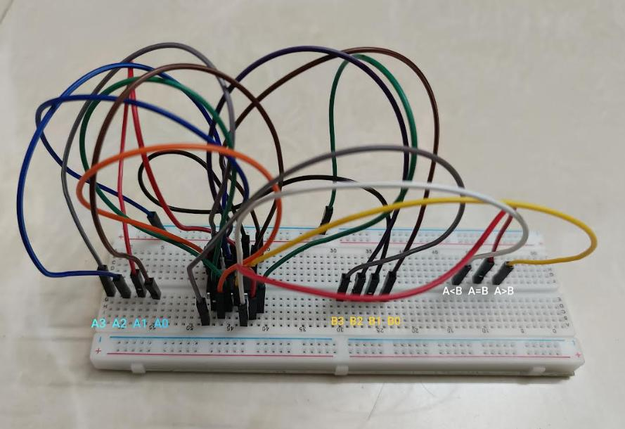
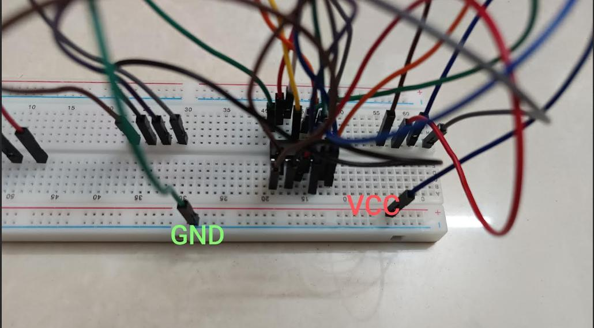

# Hardware Implementation — 4-bit Magnitude Comparator

[← Back to README](../README.md) · [Project Overview](PROJECT_OVERVIEW.md)

## Physical implementation overview

A 74LS85 4-bit magnitude comparator IC was mounted on a breadboard and wired to laboratory input
switches and output LEDs. The two genuine photographs below were taken during the original 2025
project work and are reproduced here without retouching.

*Figure 1 — The assembled prototype. The eight input positions are annotated `A3 A2 A1 A0` and
`B3 B2 B1 B0`, and the three output positions are annotated `A < B`, `A = B` and `A > B`.*

*Figure 2 — Close-up of the supply rail wiring. The rails are annotated `VCC` and `GND` (+5 V and
ground).*

## Components

The components supported by the project material are:

| Component | Role |
|---|---|
| SN74LS85 | 4-bit magnitude comparator IC at the centre of the prototype |
| Breadboard and jumper wires | Physical construction and interconnection |
| Lab switches | Eight switches driving the `A` and `B` inputs |
| LEDs | Three output indicators for the comparison results |
| 5 V DC supply | Powers the IC and indicators (`VCC` / `GND`) |

The gate-level devices listed in [Circuit Design](CIRCUIT_DESIGN.md) belong to the separate Proteus
gate-level schematic; the breadboard prototype itself is built around the 74LS85 IC.

## Input and output explanation

The input labels visible on the prototype run from most significant to least significant bit:
`A3 A2 A1 A0` and `B3 B2 B1 B0`. The three output positions are labelled by function (`A < B`,
`A = B`, `A > B`), not by component designator. Exactly one output LED is expected to be active
for any input combination.

## Physical testing observations

The photographs establish that the prototype was assembled, powered and annotated during testing.
They **do not** record the LED state for a particular input combination, so they cannot be used as
evidence of a specific comparison result. The original report describes manual checks with a
limited number of input combinations, but no structured physical test log was preserved; no such
results are claimed here.

Claims about the circuit's correctness in this repository come from the source-level verification
documented in [Testing and Results](TESTING_AND_RESULTS.md), not from the photographs.

## Related documentation

- [Simulation Guide](SIMULATION_GUIDE.md) — Proteus captures of the same function
- [Asset Index](ASSET_INDEX.md) — full illustrated catalogue
