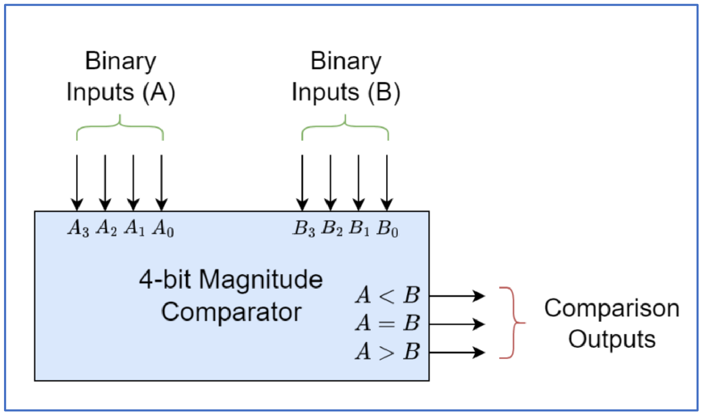

# Project Overview — 4-bit Magnitude Comparator

[← Back to README](../README.md)

## Introduction

A magnitude comparator is a combinational circuit that establishes the relative ordering of two
binary numbers. This project designs, simulates and implements a comparator for two **unsigned
4-bit** operands, producing three mutually exclusive one-hot outputs: `GT` (`A > B`), `EQ`
(`A = B`) and `LT` (`A < B`).

*Figure 1 — Comparator interface. Two 4-bit inputs enter the block and three comparison outputs
leave it. Inputs are ordered most significant bit first (`A3…A0`, `B3…B0`).*

## Objective

1. Design a 4-bit comparator circuit that compares two binary numbers.
2. Derive the logic expressions for the `A > B`, `A = B` and `A < B` conditions.
3. Analyse and verify the circuit through step-by-step reasoning and simulation.
4. Implement the comparator in hardware on a breadboard using the 74LS85 IC.

## Inputs and outputs

| Signal | Width | Meaning |
|---|---|---|
| `A` | 4 bits | First unsigned operand (`A3` = most significant) |
| `B` | 4 bits | Second unsigned operand (`B3` = most significant) |
| `GT` | 1 bit | High when `A > B` |
| `EQ` | 1 bit | High when `A = B` |
| `LT` | 1 bit | High when `A < B` |

The circuit is purely combinational: there is no clock and no stored state. For every input pair,
exactly one of the three outputs is high, so `GT + EQ + LT = 1`.

## Architecture overview

One comparison rule generates the whole design: compare from the most significant bit downwards.
The highest bit position at which the operands differ decides the result; all lower bits matter
only while the higher bits are equal.

The project realises this rule in three forms:

| Form | Where | Status |
|---|---|---|
| Gate-level circuit | Proteus schematic, built from standard logic gates | Simulated with representative input combinations |
| 74LS85 IC circuit | Proteus schematic and breadboard prototype | Simulated and physically assembled |
| Verilog models | `src/rtl/` in this repository | Compiled and exhaustively verified in 2026 |

See [Circuit Design](CIRCUIT_DESIGN.md) for the logic derivation and the two HDL models.

## Project scope

- Unsigned 4-bit operands only. Signed comparison, overflow detection and wider words were out of scope.
- No timing or propagation-delay analysis was performed.
- The gate-level design exists only as a Proteus schematic; no gate-level netlist was produced.
- Physical testing of the breadboard was manual and limited; the photographs document the assembly
  and annotations, not a specific comparison result.

## Tools used

| Tool | Role |
|---|---|
| Proteus Design Suite (Labcenter Electronics) | Circuit design and simulation |
| SN74LS85 | 4-bit magnitude comparator IC |
| 74LS04, 74LS08, 74LS02, 74LS21, 4072 | Logic gates for the gate-level schematic |
| Verilog HDL | Procedural and dataflow descriptions |
| Icarus Verilog 12.0 | Compilation and exhaustive simulation of the RTL models |
| Breadboard, switches, LEDs, 5 V supply | Physical prototype |

## Team and course context

| | |
|---|---|
| Course | CSE345 — Digital Logic Design |
| Institution | Department of Computer Science and Engineering, East West University |
| Group / Section | Group 7, Section 6 |
| Semester | Summer 2025 |
| Faculty | Nishat Tasnim |
| Submitted | September 2nd, 2025 |

Team members: Nafis Afzal, Anik Saha, Ashiqur Rahman Sohan and Raiyan Fardin Haque. The academic
work was completed collaboratively in 2025. The documentation and verification material in this
repository were prepared in 2026; the difference is identified wherever it matters.

## Documentation

- [Circuit Design](CIRCUIT_DESIGN.md)
- [Simulation Guide](SIMULATION_GUIDE.md)
- [Hardware Implementation](HARDWARE_IMPLEMENTATION.md)
- [Testing and Results](TESTING_AND_RESULTS.md)
- [Asset Index](ASSET_INDEX.md)

## Reports

- [Original submitted report (16 pages)](../reports/01_Original_Submitted_Report_2025-09-02.pdf) —
  identifier-free edition of the September 2025 submission.
- [Revised report (19 pages)](../reports/02_Revised_Report_2026-11-17.pdf) — current edition.
