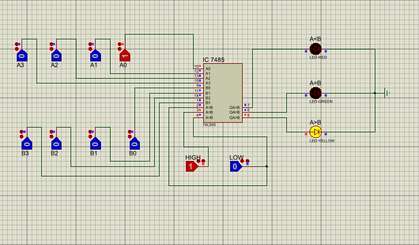
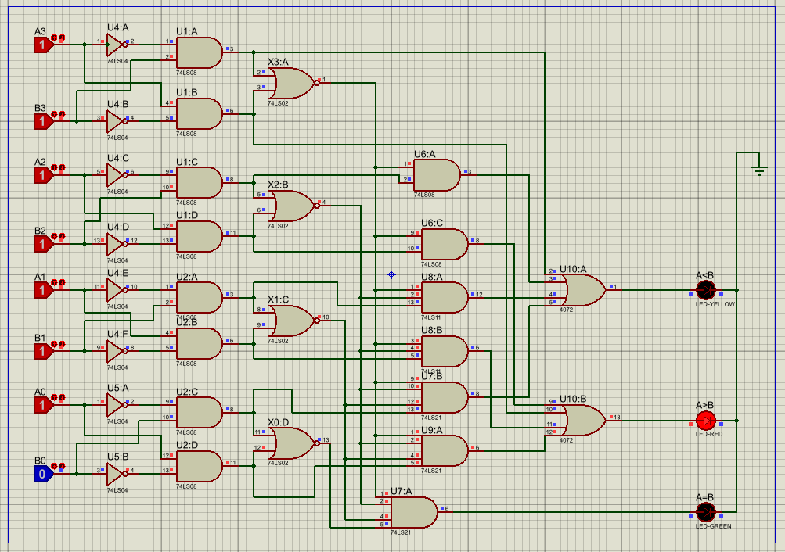

# Simulation Guide — 4-bit Magnitude Comparator

[← Back to README](../README.md) · [Circuit Design](CIRCUIT_DESIGN.md)

## Proteus simulation environment

The circuit-level evidence in this repository consists of **thirteen genuine Proteus screenshots**
extracted from the original 2025 report. Each capture shows a working schematic with a particular
input combination selected. The original Proteus project files (`.DSN`) were not part of the
submission and are not available, so no schematic has been redrawn and no Proteus simulation has
been regenerated for this repository.

Two schematics were simulated:

| Schematic | Captures | Devices |
|---|---|---|
| 74LS85-based comparator | 10 | SN74LS85 IC, eight input switches, HIGH/LOW indicators, three output LEDs |
| Gate-level comparator | 3 | 74LS04, 74LS08, 74LS02, 74LS21, 4072 |

In each capture, the eight switches at the left set `A3…A0` and `B3…B0`, and one of the three
output LEDs on the right is illuminated.

## Representative captures



*Figure 1 — 74LS85 circuit with `A = 0001`, `B = 0000`. The `A > B` indicator is lit, which agrees
with the operand values.*



*Figure 2 — Gate-level circuit with `A = 1111`, `B = 1110`. The `A > B` indicator is lit.*

## The thirteen captures

Every capture was read by identifying the eight switch levels and the single lit LED, then
comparing the observed indicator with the expected comparison. All thirteen agree.

| # | Schematic | A | B | Expected | File |
|---|---|---|---|---|---|
| 1 | 74LS85 | `0000` | `0000` | `A = B` | [eq](assets/simulation/proteus-74ls85-a0000-b0000-eq.png) |
| 2 | 74LS85 | `0001` | `0000` | `A > B` | [gt](assets/simulation/proteus-74ls85-a0001-b0000-gt.png) |
| 3 | 74LS85 | `0001` | `0001` | `A = B` | [eq](assets/simulation/proteus-74ls85-a0001-b0001-eq.png) |
| 4 | 74LS85 | `0011` | `0001` | `A > B` | [gt](assets/simulation/proteus-74ls85-a0011-b0001-gt.png) |
| 5 | 74LS85 | `0011` | `0101` | `A < B` | [lt](assets/simulation/proteus-74ls85-a0011-b0101-lt.png) |
| 6 | 74LS85 | `0111` | `0101` | `A > B` | [gt](assets/simulation/proteus-74ls85-a0111-b0101-gt.png) |
| 7 | 74LS85 | `1001` | `1000` | `A > B` | [gt](assets/simulation/proteus-74ls85-a1001-b1000-gt.png) |
| 8 | 74LS85 | `1001` | `1010` | `A < B` | [lt](assets/simulation/proteus-74ls85-a1001-b1010-lt.png) |
| 9 | 74LS85 | `1100` | `1011` | `A > B` | [gt](assets/simulation/proteus-74ls85-a1100-b1011-gt.png) |
| 10 | 74LS85 | `1111` | `1111` | `A = B` | [eq](assets/simulation/proteus-74ls85-a1111-b1111-eq.png) |
| 11 | Gate level | `0000` | `0000` | `A = B` | [eq](assets/simulation/proteus-gates-a0000-b0000-eq.png) |
| 12 | Gate level | `1000` | `0000` | `A > B` | [gt](assets/simulation/proteus-gates-a1000-b0000-gt.png) |
| 13 | Gate level | `1111` | `1110` | `A > B` | [gt](assets/simulation/proteus-gates-a1111-b1110-gt.png) |

The set covers all three outcomes and a spread of operands from `0` to `15`, including the boundary
cases `15 = 15`, `9` versus `10`, and `12` versus `11`. A full illustrated catalogue is in the
[Asset Index](ASSET_INDEX.md).

## Output indicator colours

The two schematics use **different LED colours for the same function** — a difference found during
the 2026 audit and stated here so no reader misinterprets the images.

| Function | 74LS85 schematic | Gate-level schematic |
|---|---|---|
| `A < B` | LED-RED | LED-YELLOW |
| `A = B` | LED-GREEN | LED-GREEN |
| `A > B` | LED-YELLOW | LED-RED |

The functional result in each capture is correct; only the colour assignment differs. The text
label above each LED names the function it reports. No colour-to-result mapping is claimed for the
physical prototype, because the photographs do not establish one.

## Expected output behaviour

For any pair of unsigned 4-bit inputs, exactly one output is high. The Proteus material is a set of
thirteen spot checks; it does not constitute an exhaustive proof. The exhaustive check is the HDL
simulation below.

## Reproducing the RTL simulation

The Verilog source files in this repository can be compiled and simulated with Icarus Verilog:

```bash
iverilog -g2005 -Wno-timescale -o build/comparator_4bit_tb.vvp \
         src/rtl/comparator_4bit_procedural.v \
         src/rtl/comparator_4bit_dataflow.v \
         src/tb/comparator_4bit_tb.v
vvp build/comparator_4bit_tb.vvp
```

The verified result and the exact tool version are in [Testing and Results](TESTING_AND_RESULTS.md).
This command verifies the two Verilog models only — it does not verify the Proteus schematics or
the physical hardware.
